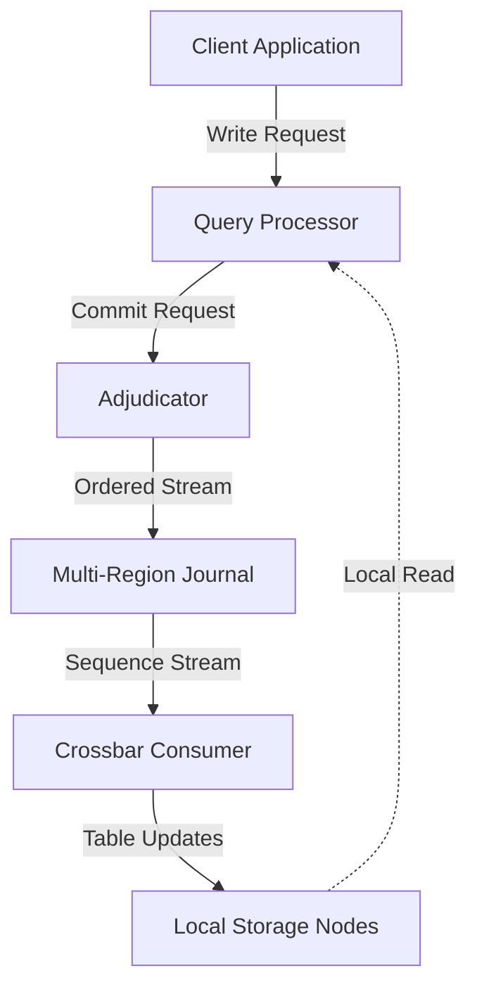
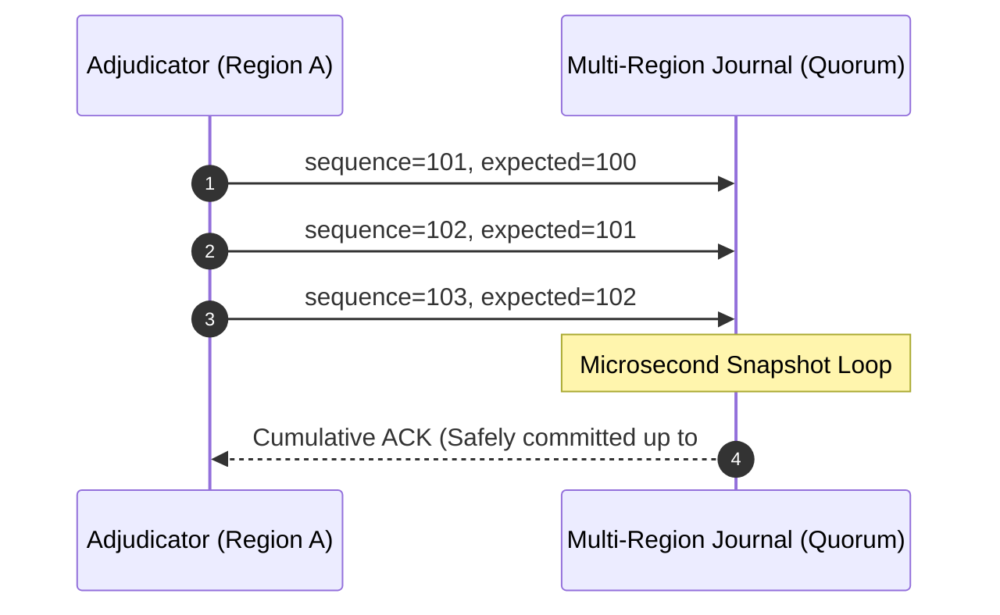
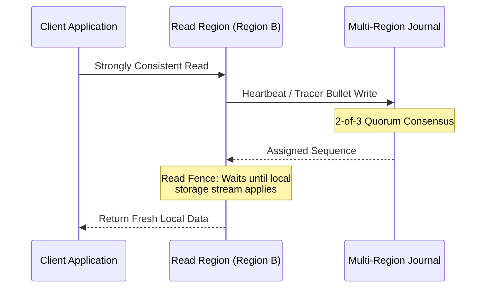
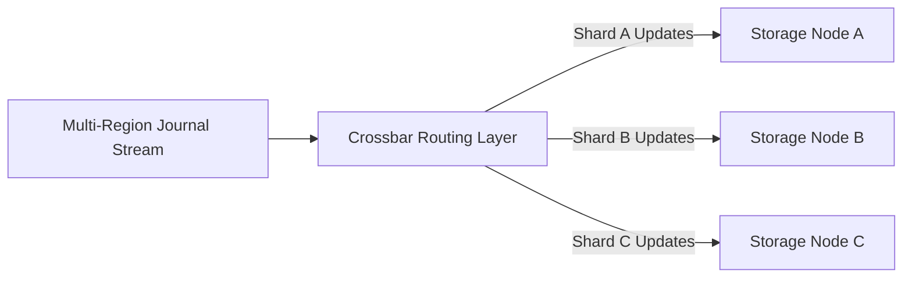

> [!abstract] Executive Summary
> The **Multi-Region Journal (MRJ)** is a foundational, disaggregated replication system built by AWS to power global, active-active databases with **Zero RPO** (zero data loss) and **Strong Consistency**. It is the core engine behind Amazon DynamoDB's Multi-Region Strong Consistency (MRSC) and Amazon Aurora DSQL. It mathematically eliminates cross-region write conflicts by forcing all global transactions into a single, strictly ordered, append-only log.

---

## 1. Disaggregated Architecture

Unlike traditional databases where a single node handles querying, transaction ordering, and storage, systems relying on the MRJ disaggregate these responsibilities:

* **Query Processor (QP):** Handles client connection management, query parsing, and local read evaluation.
* **Adjudicator:** The transaction manager. Detects conflicts and acts as the "client/sender" streaming ordered writes into the journal.
* **Multi-Region Journal (MRJ):** A highly durable, purely append-only distributed log. It is **not** the database table storage; it is the global source of truth for event order.
* **Crossbar & Storage Nodes:** Asynchronous downstream consumers that read the journal sequence and apply changes to local tables, indexes, and B-trees.

---

## 2. The Write Path: Pipelining & Expected Sequences

To achieve massive throughput without waiting for transatlantic network round-trips (75ms+ latency), the Adjudicator streams writes continuously using **Chained Pipelining**. 

Every write packet carries a strict mathematical precondition:
$$\text{Payload} = \{\text{sequence}=N, \text{expected}=N-1\}$$

> [!danger] The Failure Cascade
> If `sequence=102` is dropped due to a network glitch, the remote journal automatically rejects `sequence=103` because its precondition (`expected=102`) failed. This mathematical guarantee makes out-of-order commits impossible. The Adjudicator instantly rewinds its RAM buffer and resends from the point of failure.

---

## 3. High Throughput: Cumulative ACKs & The Escalator Model

The Adjudicator never intentionally delays writes to build artificial "batches"—doing so would punish client latency. Instead, it uses **dynamic return-path bundling**:

* **Escalator Model:** Individual writes enter the pipeline immediately without artificial wait times.
* **Group Commit (Hardware Layer):** At the physical storage layer, NVMe SSDs fuse incoming writes into physical silicon in unified disk flushes.
* **Microsecond Snapshot Loop:** The journal continuously polls its disk state and returns a **Cumulative ACK** (e.g., `"Committed through #105"`).
* **Implicit Guarantees:** Because sequence numbers are strictly chained, acknowledging `#105` mathematically confirms that `#101` through `#104` are durable.

---

## 4. The Read Path: Heartbeats (Tracer Bullets)

To guarantee **Strong Consistency** without global database locks, local read regions must verify they aren't serving stale data or operating under a network partition (split-brain).

1. **Tracer Bullet Injection:** The local region appends a tiny, empty marker (the heartbeat) into the Multi-Region Journal.
2. **Quorum Serialization:** The journal processes the heartbeat via 2-of-3 quorum and assigns it the next global sequence number (e.g., `#5001`).
3. **Read Fence:** The local region pauses the read request until its local storage engine processes all journal changes up to `#5001`.
4. **Execution:** Once `#5001` is processed locally, the fence drops and the read request executes against guaranteed up-to-date local data.

> [!note] Latency Tradeoff
> Because the heartbeat must achieve multi-region quorum to establish the serialization point, a strongly consistent read inherently incurs the cross-region round-trip latency of a write operation.

---

## 5. Fault Tolerance: Witness Region & Zero RPO

The journal achieves durability using a **2-of-3 Region Quorum**. To avoid tripling full storage costs, AWS utilizes a specialized topology:

| Region Type | Journal Replica | Full Database Storage | Client Traffic |
| :--- | :---: | :---: | :---: |
| **Primary Region** | Yes | Yes | Active |
| **Secondary Region** | Yes | Yes | Active |
| **Witness Region** | Yes | **No** (Log Only) | None |

> [!success] Zero RPO Failover
> If an entire full region goes offline, the surviving full region and the Witness Region still hold a valid 2-of-3 majority quorum. A new Adjudicator initializes in the surviving region, reads the highest agreed sequence number from the Witness, and resumes processing without losing a single acknowledged transaction (**Zero RPO**).

## 6. The Crossbar: Merge-Sorting and Routing the Global Log

> [!abstract] Definition & Purpose
> The **Crossbar** is the high-performance routing and distribution layer that sits directly between the Multi-Region Journal and the local database storage nodes. It solves the "impedance mismatch" between a single, globally ordered transaction firehose and heavily partitioned (sharded) storage infrastructure.

---

### 1. The Sharding Impedance Mismatch
* **The Global Firehose:** Every write across the entire global database passes through the Multi-Region Journal as a single, totally ordered stream.
* **The Storage Shards:** Actual table data is range-partitioned and sharded across hundreds or thousands of individual storage nodes. 
* **The Problem:** If every storage node subscribed directly to the global journal, every node would drown trying to filter out millions of unrelated transactions. 

### 2. How the Crossbar Works
The Crossbar acts as an intelligent sorting and multiplexing engine:

1. **Reading and Merge-Sorting:** Crossbar nodes continuously read the sequence of committed transaction streams coming from the journals.
2. **Filtering and Demultiplexing:** As it processes the records, it inspects the transaction metadata (such as table IDs and shard/partition keys).
3. **Targeted Routing:** It splits the global stream into thousands of narrow, dedicated feeds, ensuring that a specific storage node only receives the updates relevant to its assigned shard.

> [!important] Preservation of Sequence Order
> While the Crossbar distributes data outward to fragmented storage nodes, it strictly maintains the ordering constraints established by the journal. Storage nodes apply changes in the exact sequence determined by the global consensus log.

